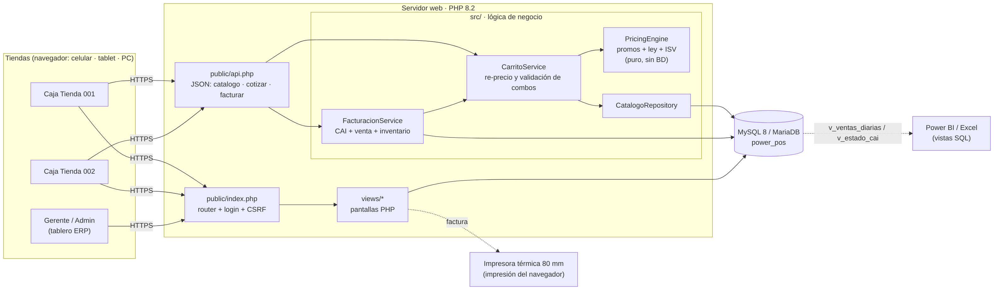
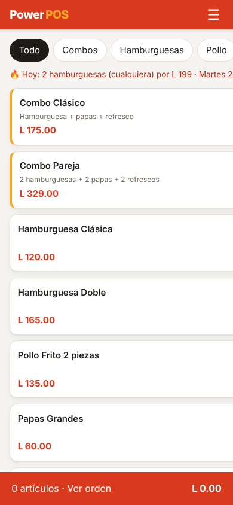
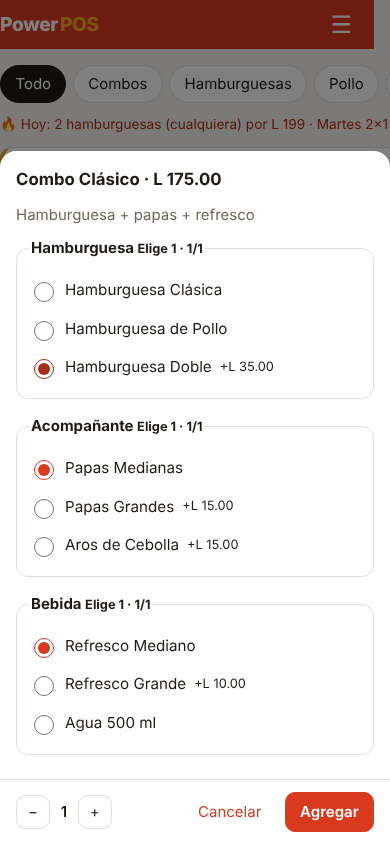
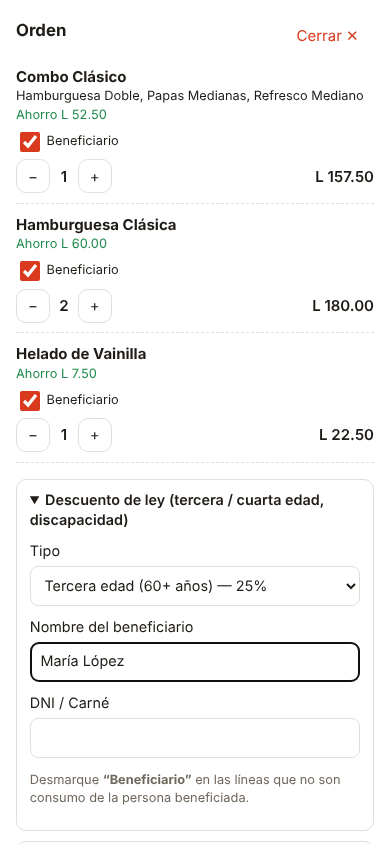
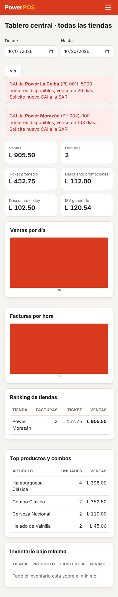
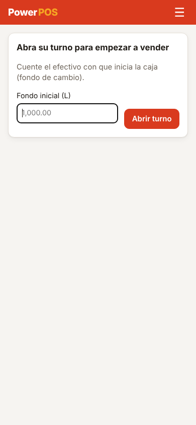
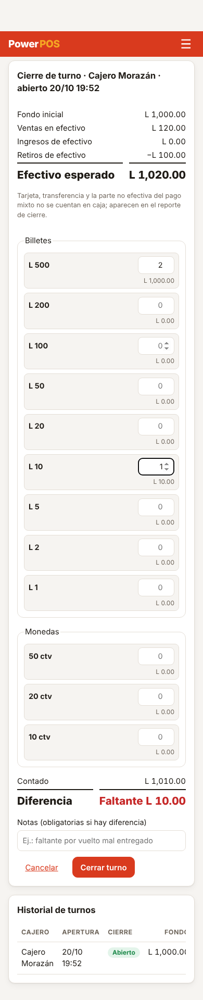
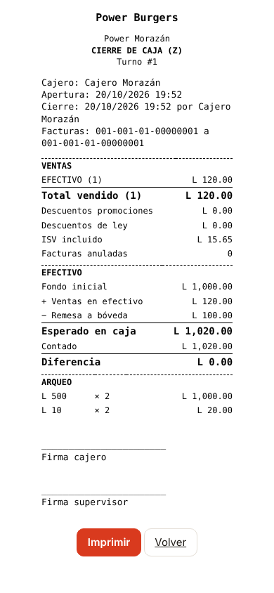
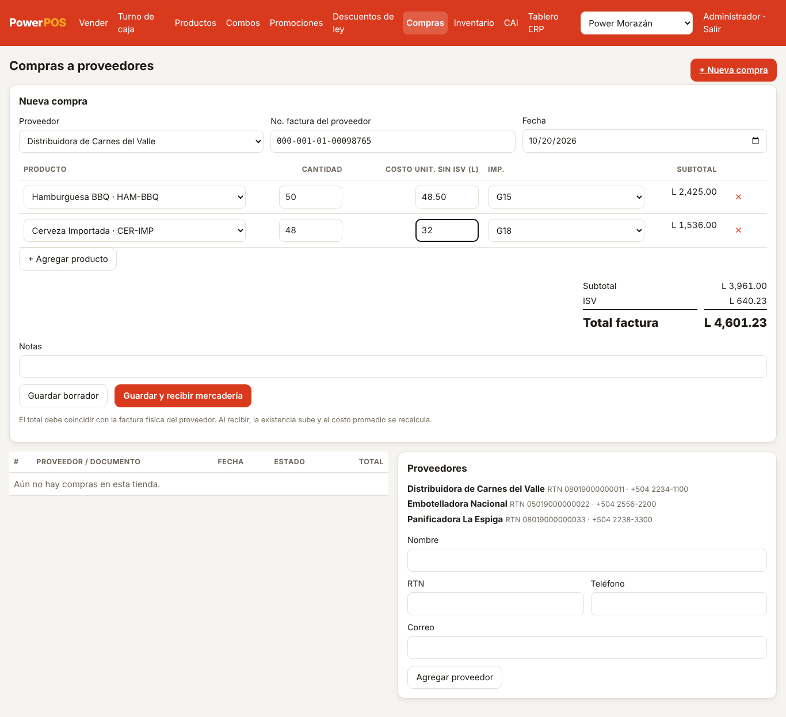
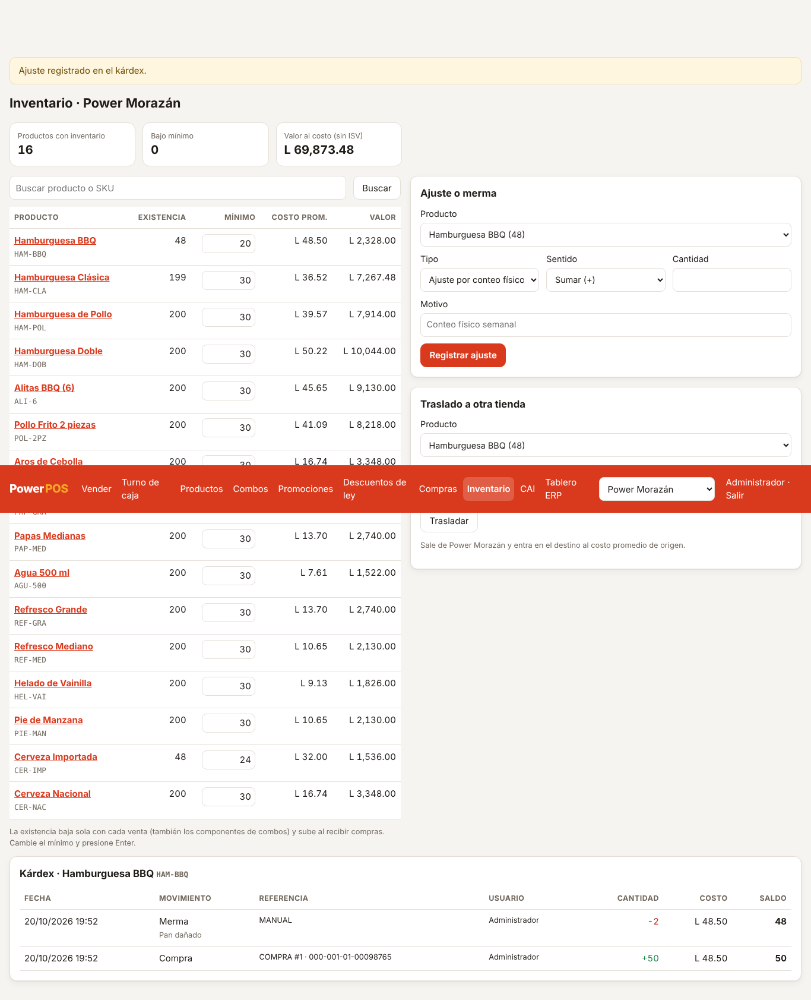

# Power POS 🍔

Plataforma web para **comidas rápidas en Honduras**: caja con armado de combos, promociones *mix & match*,
descuentos de ley (tercera edad, cuarta edad, discapacidad), **facturación con CAI (SAR)** y un **mini ERP** que centraliza todas las tiendas.
Hecha en **PHP + MySQL** y responsive (pensada primero para el teléfono).

📄 Propuesta completa y análisis de procesos: [`docs/PROPUESTA.md`](docs/PROPUESTA.md)
🏗️ Arquitectura, diagrama entidad-relación, flujos y seguridad: [`docs/ARQUITECTURA.md`](docs/ARQUITECTURA.md)
📘 Manual interactivo (guías por rol, simulador de caja, validador de CAI, autoevaluación): [`docs/manual/manual.html`](docs/manual/manual.html)



| Caja (móvil) | Armar combo | Orden + descuento de ley | Tablero ERP |
|---|---|---|---|
|  |  |  |  |

| Abrir turno | Arqueo | Cierre Z | Compra | Inventario y kárdex |
|---|---|---|---|---|
|  |  |  |  |  |

## Instalación

Requisitos: PHP 8.2+ con `pdo_mysql`, y MySQL 8 o MariaDB 10.6+.

```bash
mysql -u root -p < database/schema.sql
mysql -u root -p < database/seed.sql          # datos de demostración
cp config/config.example.php config/config.php # ajuste usuario y clave de la BD
php -S localhost:8080 -t public                # o apunte Apache/Nginx a /public
```

Ingrese en http://localhost:8080 con **admin@power.hn / Power2026!** (cajero: `caja1@power.hn`, misma clave).
Antes de vender, cada cajero **abre su turno** con el fondo inicial.
**Cambie estas claves antes de producción.**

También puede configurar la BD con las variables de entorno `DB_DSN`, `DB_USER` y `DB_PASS`.

## Pruebas

```bash
php tests/run.php          # motor de precios, promos, ley, ISV y montos en letras (sin BD)

# Integración: caja, ventas, compras, inventario y CSV (use una BD de PRUEBA recién cargada)
DB_DSN='mysql:host=127.0.0.1;dbname=power_pos;charset=utf8mb4' DB_USER=root DB_PASS= php tests/integracion.php
```

### Publicar en Hostinger

```bash
bash deploy/empaquetar-hostinger.sh   # genera dist/subir-a-public_html.zip y dist/instalar.sql
```

Paso a paso en hPanel (base de datos, phpMyAdmin, Administrador de archivos y SSL): [`docs/HOSTINGER.md`](docs/HOSTINGER.md)

### Actualizar una instalación existente

```bash
mysql -u root -p < database/migraciones/002_caja_compras_inventario.sql
```

## Módulos

| Pantalla | Rol | Qué hace |
|---|---|---|
| Caja | Todos | Catálogo, armado de combos, carrito, descuento de ley, RTN y facturación |
| Combos | Admin, Gerente | Crear combos con grupos (mín./máx.), recargos y opción por defecto |
| Promociones | Admin, Gerente | Mix & match, NxM, %, compra X lleva Y, por día, hora y tienda |
| Descuentos de ley | Admin | % y topes parametrizables, acumulable, exento ISV y reporte del mes |
| CAI | Admin | Registro de CAI por tienda y punto de emisión, consumo del rango y alertas |
| Turno de caja | Todos | Apertura con fondo, retiros e ingresos, corte X, arqueo por denominación, cierre Z |
| Productos | Admin, Gerente | Alta y edición, carga masiva CSV o Excel |
| Compras | Admin, Gerente | Proveedores, compras en borrador o recibidas, entrada a inventario con costo |
| Inventario | Admin, Gerente | Existencias, mínimos, ajustes, mermas, traslados y kárdex |
| Tablero ERP | Admin, Gerente | KPIs consolidados, compras, diferencias de caja, ranking, top de artículos e inventario |

> ⚠️ Los porcentajes de los descuentos de ley y el tratamiento del ISV vienen como **valores por defecto parametrizables**.
> Valídelos con su asesor legal/contable y la normativa vigente de la SAR antes de usar el sistema en producción.
> Los CAI del seed son ficticios.
