# Power POS 🍔

Plataforma web para **comidas rápidas en Honduras**: caja con armado de combos, promociones *mix & match*,
descuentos de ley (tercera edad, cuarta edad, discapacidad), **facturación con CAI (SAR)** y un **mini ERP** que centraliza todas las tiendas.
Hecha en **PHP + MySQL** y responsive (pensada primero para el teléfono).

📄 Propuesta completa y análisis de procesos: [`docs/PROPUESTA.md`](docs/PROPUESTA.md)
🧭 Menú administrativo, menú de tienda y Configuración: [`docs/MENUS.md`](docs/MENUS.md)
🏗️ Arquitectura, diagrama entidad-relación, flujos y seguridad: [`docs/ARQUITECTURA.md`](docs/ARQUITECTURA.md)
📘 Manual interactivo (guías por rol, simulador de caja, validador de CAI, autoevaluación): [`docs/manual/manual.html`](docs/manual/manual.html)

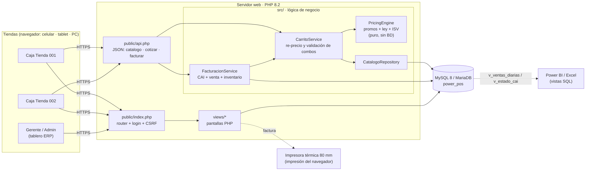

| Caja (móvil) | Armar combo | Orden + descuento de ley | Tablero ERP |
|---|---|---|---|
| 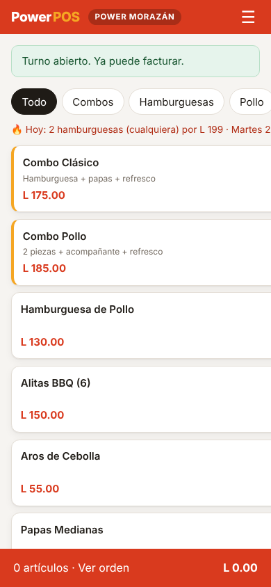 | 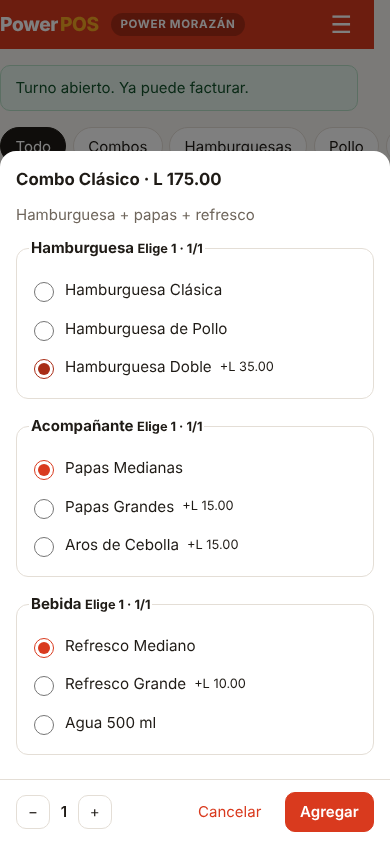 | 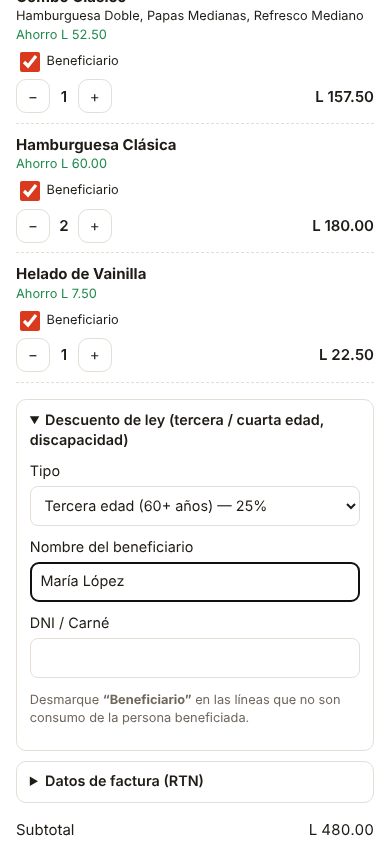 | 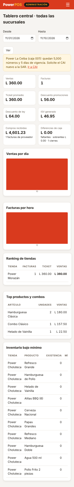 |

| Abrir turno | Arqueo | Cierre Z | Compra | Inventario y kárdex |
|---|---|---|---|---|
| 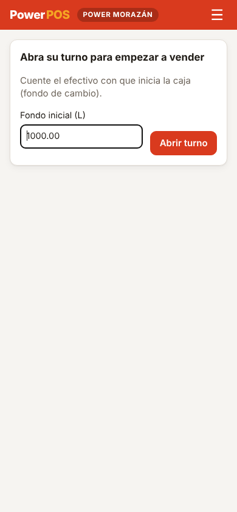 | 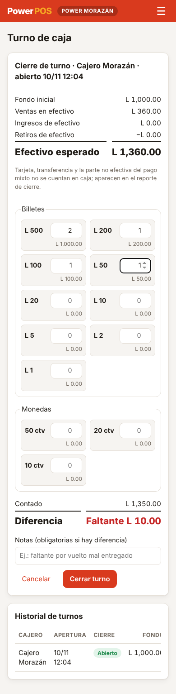 | 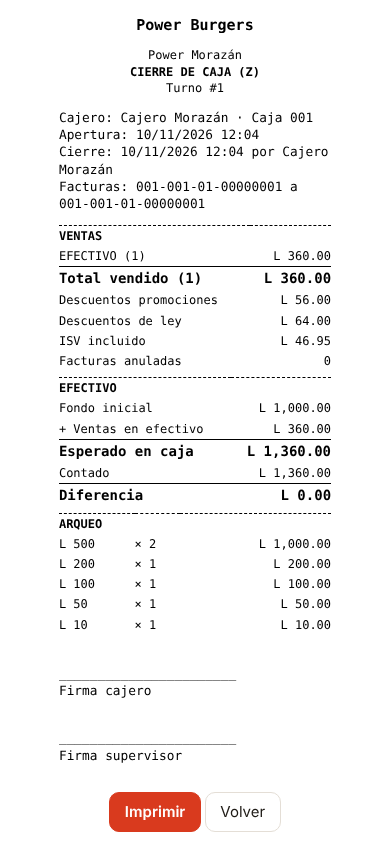 | 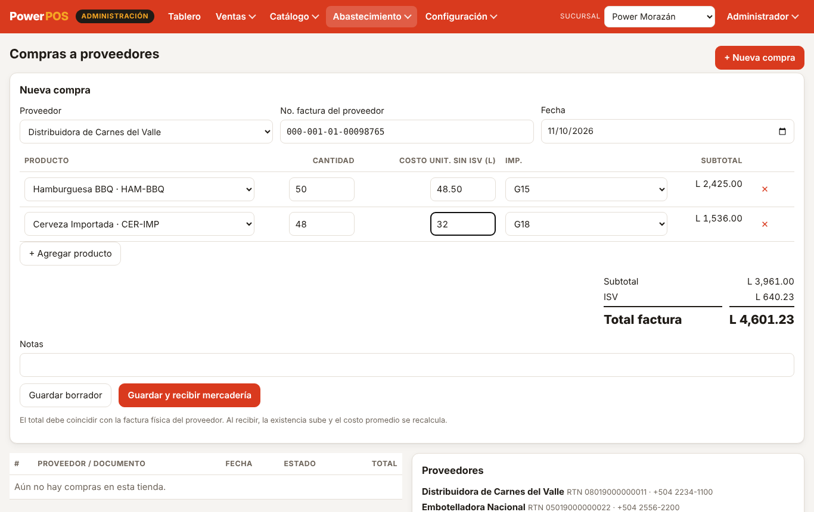 | 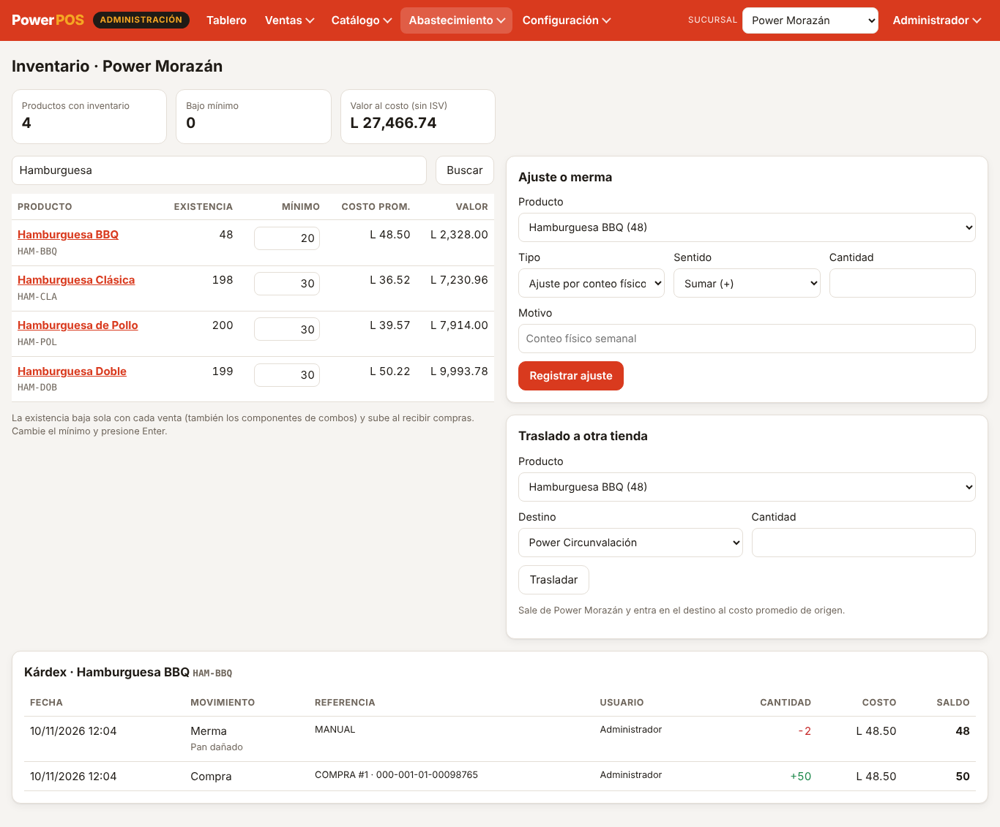 |

| Menú administrativo | Configuración | Sucursales | CAI por caja |
|---|---|---|---|
| 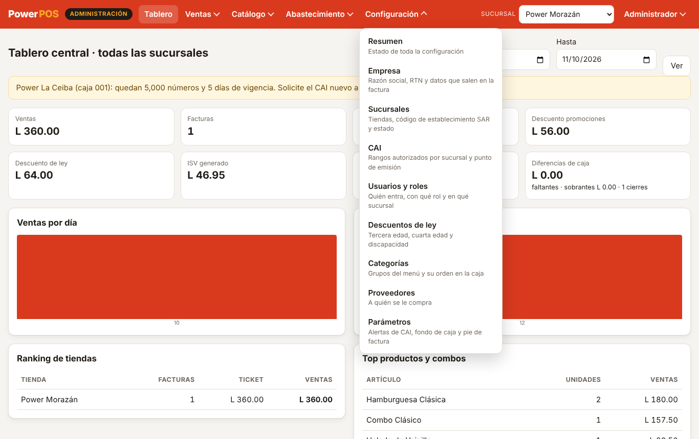 | 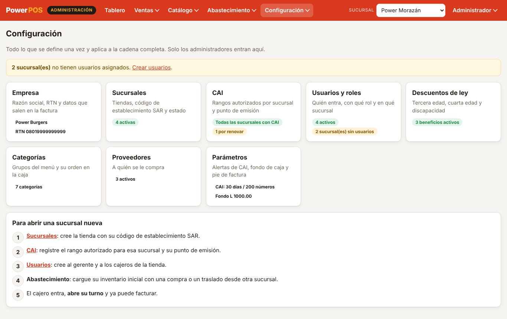 | 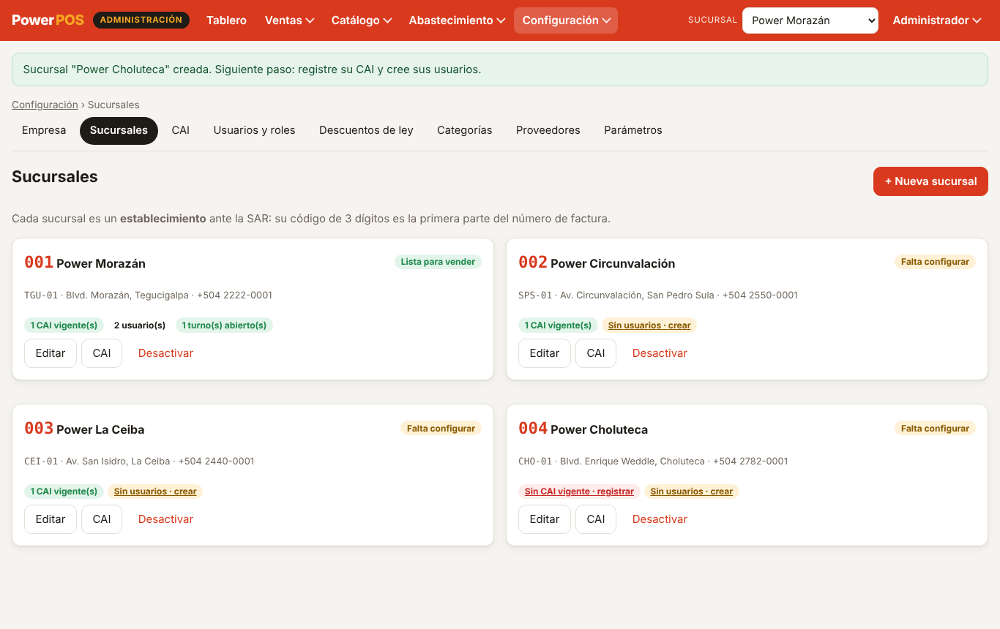 | 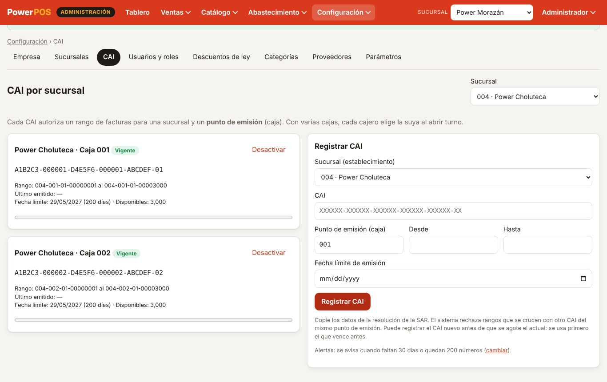 |

| Menú de tienda (cajero) | Menú del gerente de tienda | Elegir caja al abrir turno | Facturas |
|---|---|---|---|
| 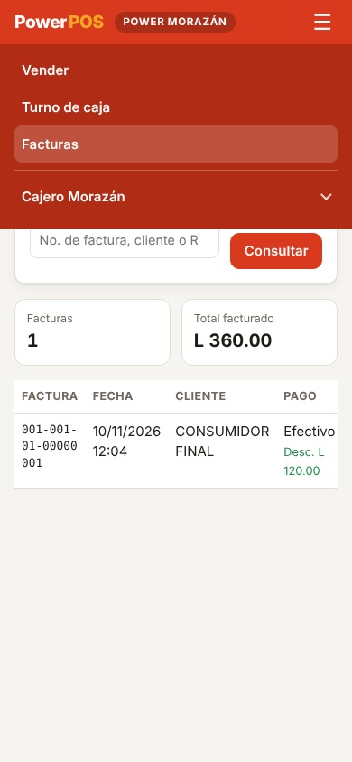 | 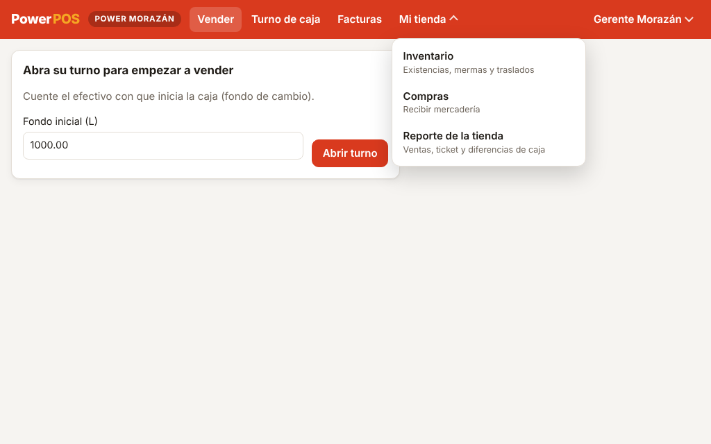 | 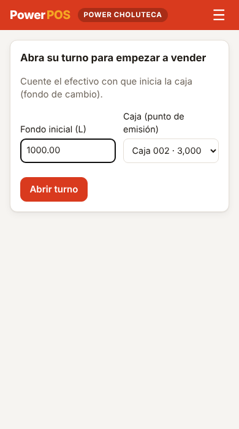 | 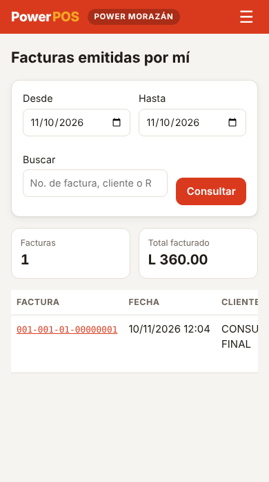 |

## Instalación

Requisitos: PHP 8.2+ con `pdo_mysql`, y MySQL 8 o MariaDB 10.6+.

```bash
mysql -u root -p < database/schema.sql
mysql -u root -p < database/seed.sql          # datos de demostración
cp config/config.example.php config/config.php # ajuste usuario y clave de la BD
php -S localhost:8080 -t public                # o apunte Apache/Nginx a /public
```

Ingrese en http://localhost:8080 con **admin@power.hn / Power2026!**. Usuarios de ejemplo con la misma clave:
`caja1@power.hn` (cajero) y `gerente1@power.hn` (gerente de tienda), ambos de Power Morazán.
Antes de vender, cada cajero **abre su turno** con el fondo inicial.
**Cambie estas claves antes de producción.**

También puede configurar la BD con las variables de entorno `DB_DSN`, `DB_USER` y `DB_PASS`.

## Pruebas

```bash
php tests/run.php          # motor de precios, promos, ley, ISV y montos en letras (sin BD)

# Integración: caja, ventas, compras, inventario y CSV (use una BD de PRUEBA recién cargada)
DB_DSN='mysql:host=127.0.0.1;dbname=power_pos;charset=utf8mb4' DB_USER=root DB_PASS= php tests/integracion.php
```

### Actualizar una instalación existente

```bash
mysql -u root -p < database/migraciones/002_caja_compras_inventario.sql   # desde la versión 1
mysql -u root -p < database/migraciones/003_configuracion.sql             # desde la versión 2
```

## Módulos

Hay dos menús: el **de tienda** (usuarios con sucursal asignada) y el **administrativo** (oficina central).

| Pantalla | Menú | Quién | Qué hace |
|---|---|---|---|
| Vender | Ambos | Todos | Catálogo, armado de combos, descuento de ley, cobro con cambio y factura |
| Turno de caja | Ambos | Todos | Apertura con fondo y caja, retiros e ingresos, corte X, arqueo y cierre Z |
| Facturas | Ambos | Todos | Consulta y reimpresión (el cajero ve las suyas) |
| Mi cuenta | Ambos | Todos | Cambio de contraseña |
| Inventario | Ambos | Gerentes y administrador | Existencias, mínimos, ajustes, mermas, traslados y kárdex |
| Compras | Ambos | Gerentes y administrador | Proveedores, compras en borrador o recibidas, costo promedio |
| Tablero / Reporte de la tienda | Ambos | Gerentes y administrador | KPIs, compras, diferencias de caja, ranking y alertas de CAI |
| Productos | Administrativo | Oficina central | Alta, edición y carga masiva CSV |
| Combos | Administrativo | Oficina central | Grupos de selección (mín./máx.), recargos y opción por defecto |
| Promociones | Administrativo | Oficina central | Mix & match, NxM, %, compra X lleva Y, por día, hora y sucursal |
| Configuración | Administrativo | Administrador | Empresa, sucursales, CAI por caja, usuarios, descuentos de ley, categorías, proveedores y parámetros |

> ⚠️ Los porcentajes de los descuentos de ley y el tratamiento del ISV vienen como **valores por defecto parametrizables**.
> Valídelos con su asesor legal/contable y la normativa vigente de la SAR antes de usar el sistema en producción.
> Los CAI del seed son ficticios.
