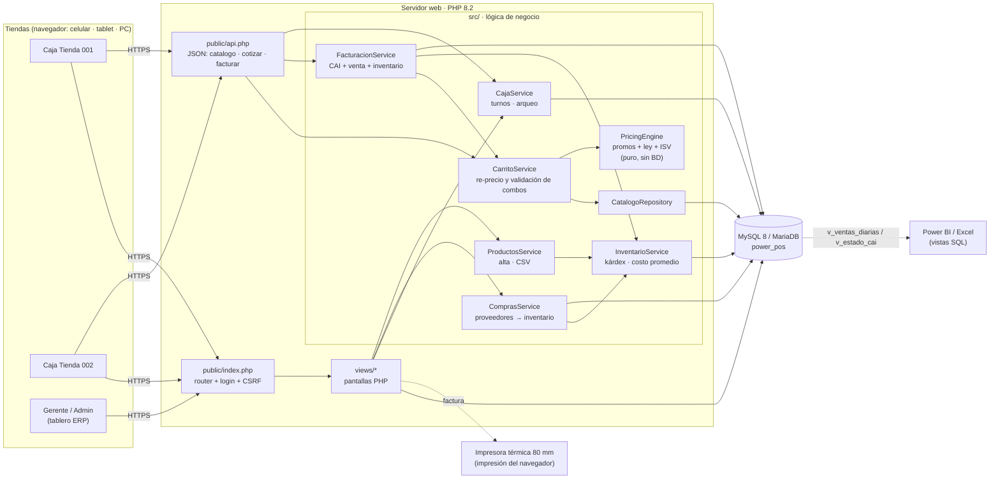
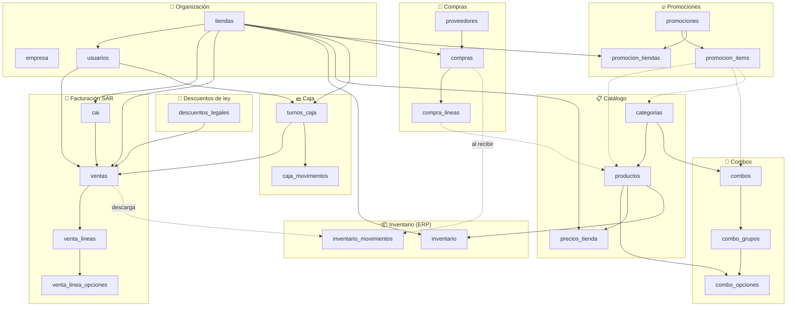
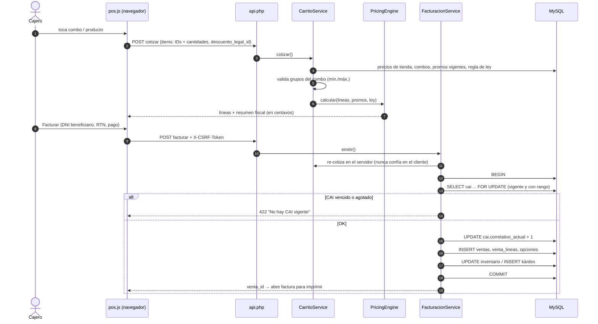
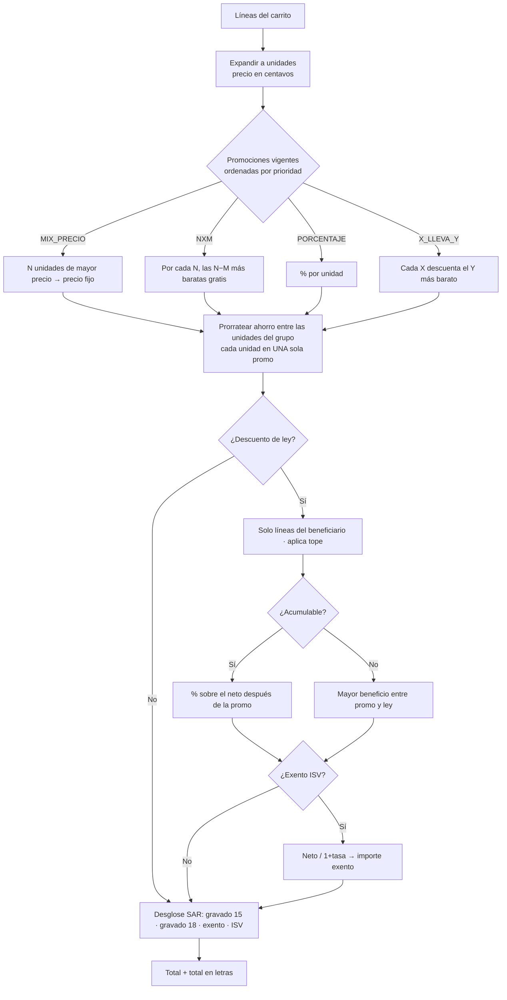
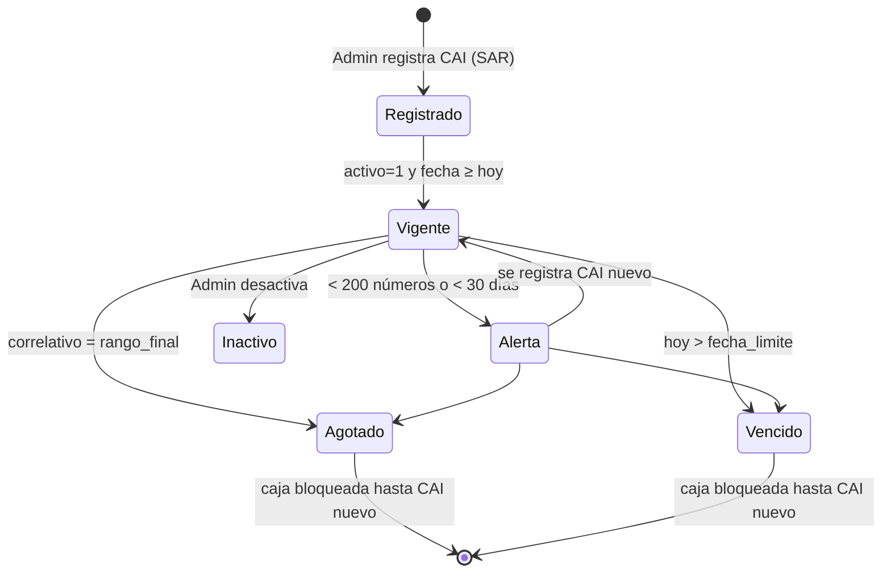
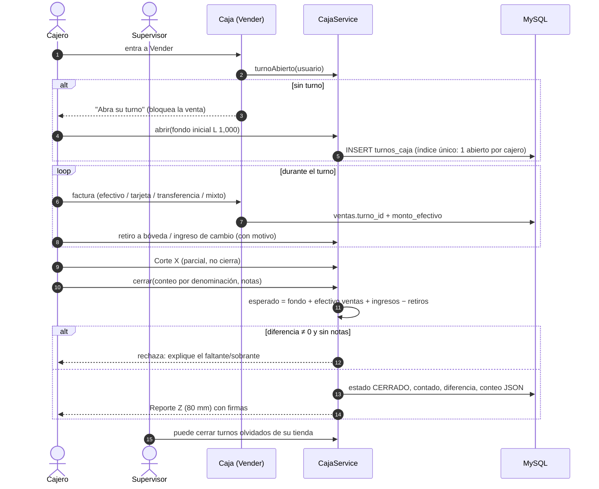
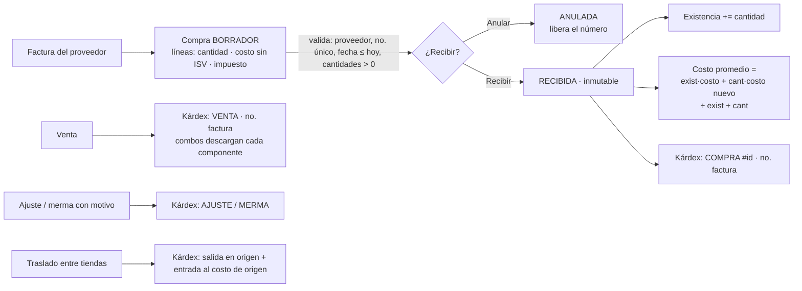
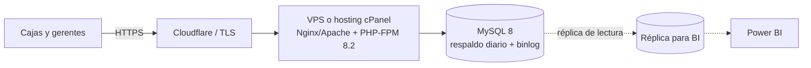

# Power POS — Arquitectura y modelo de datos

> Los diagramas están en **Mermaid** (GitHub los dibuja automáticamente). También hay versiones en imagen en [`docs/diagramas/`](diagramas/).

---

## 1. Arquitectura general

Es una arquitectura **centralizada en línea**: todas las tiendas usan la misma aplicación web y la misma base de datos.
El consolidado del ERP es en tiempo real y no hay procesos de sincronización.



### Capas y responsabilidades

| Capa | Archivos | Responsabilidad | Regla clave |
|---|---|---|---|
| Presentación | `public/assets/*.css,js`, `views/*.php` | UI responsive, armado del carrito | **Nunca** calcula montos que se cobran |
| Entrada | `public/index.php`, `public/api.php` | Ruteo, sesión, roles, CSRF, JSON | Valida el token en todo POST |
| Aplicación | `src/Ventas/*`, `src/Caja/*`, `src/Compras/*`, `src/Inventario/*`, `src/Catalogo/ProductosService.php` | Casos de uso: cotizar, facturar, turnos, compras, inventario | Transacción única por operación; todo cambio de existencia deja movimiento en kárdex |
| Dominio | `src/Pricing/PricingEngine.php` | Promos, descuentos de ley, ISV | Puro: sin BD, 100 % testeable |
| Datos | `src/Catalogo/*`, `src/Support/Database.php` | Consultas PDO preparadas | Montos en **centavos (INT)** |

### Estructura del repositorio
```
Power/
├── public/                 ← ÚNICO directorio expuesto por Apache/Nginx
│   ├── index.php           router de pantallas
│   ├── api.php             API JSON del POS
│   └── assets/             app.css · pos.js
├── views/                  _layout · login · pos · caja · cierre · productos · compras · inventario · combos · promociones · descuentos · cai · erp · factura
├── src/
│   ├── bootstrap.php       autoload PSR-4 (App\ → src/), zona horaria America/Tegucigalpa
│   ├── Pricing/            PricingEngine
│   ├── Ventas/             CarritoService · FacturacionService
│   ├── Caja/               CajaService (apertura, movimientos, arqueo, cierre)
│   ├── Compras/            ComprasService (borrador → recibida)
│   ├── Inventario/         InventarioService (kárdex, ajustes, traslados, costo promedio)
│   ├── Catalogo/           CatalogoRepository · ProductosService (alta y CSV)
│   └── Support/            Database · Auth · Money · NumeroALetras
├── config/                 config.example.php (config.php fuera de git)
├── database/               schema.sql · seed.sql · migraciones/002_caja_compras_inventario.sql
├── tests/                  run.php (motor) · integracion.php (caja, compras, inventario contra MySQL)
└── docs/                   PROPUESTA · ARQUITECTURA · capturas · diagramas
```

---

## 2. Modelo entidad-relación

### 2.1 Vista general por módulos



### 2.2 Diagrama entidad-relación completo

```mermaid
erDiagram
    empresa {
        tinyint id PK "siempre 1"
        varchar razon_social
        varchar nombre_comercial
        char rtn "14 dígitos"
        varchar direccion
        varchar telefono
        varchar email
    }
    tiendas {
        int id PK
        varchar codigo UK "TGU-01"
        varchar nombre
        varchar direccion
        varchar telefono
        char codigo_establecimiento "SAR: 001"
        tinyint activa
    }
    usuarios {
        int id PK
        int tienda_id FK "NULL = todas"
        varchar nombre
        varchar email UK
        varchar password_hash "bcrypt"
        enum rol "ADMIN GERENTE CAJERO"
        tinyint activo
    }
    categorias {
        int id PK
        varchar nombre
        smallint orden
    }
    productos {
        int id PK
        int categoria_id FK
        varchar sku UK
        varchar nombre
        int precio_centavos "con ISV"
        enum tipo_impuesto "G15 G18 EXE"
        tinyint vendible_solo
        tinyint controla_stock
        tinyint activo
    }
    precios_tienda {
        int tienda_id PK,FK
        int producto_id PK,FK
        int precio_centavos
    }
    combos {
        int id PK
        int categoria_id FK
        varchar nombre
        varchar descripcion
        int precio_centavos "con ISV"
        enum tipo_impuesto
        tinyint activo
    }
    combo_grupos {
        int id PK
        int combo_id FK
        varchar nombre "Elige tu bebida"
        tinyint min_sel
        tinyint max_sel
        smallint orden
    }
    combo_opciones {
        int id PK
        int grupo_id FK
        int producto_id FK
        int recargo_centavos
        tinyint por_defecto
    }
    promociones {
        int id PK
        varchar nombre
        enum tipo "MIX_PRECIO NXM PORCENTAJE X_LLEVA_Y"
        tinyint cantidad_n
        tinyint cantidad_m
        int precio_centavos
        decimal porcentaje
        smallint prioridad
        date fecha_inicio
        date fecha_fin
        varchar dias_semana "1234567"
        time hora_inicio
        time hora_fin
        tinyint activa
    }
    promocion_items {
        int id PK
        int promocion_id FK
        enum grupo "A=participa B=premio"
        int producto_id FK "opcional"
        int combo_id FK "opcional"
        int categoria_id FK "opcional"
    }
    promocion_tiendas {
        int promocion_id PK,FK
        int tienda_id PK,FK
    }
    descuentos_legales {
        int id PK
        varchar codigo UK "TERCERA_EDAD"
        varchar nombre
        decimal porcentaje
        int tope_centavos "0 = sin tope"
        tinyint edad_minima
        tinyint acumulable_promos
        tinyint exento_isv
        tinyint requiere_documento
        varchar base_legal
        tinyint activo
    }
    cai {
        int id PK
        int tienda_id FK
        char cai UK "37 caracteres"
        char punto_emision "001"
        char tipo_documento "01 factura"
        int rango_inicial
        int rango_final
        int correlativo_actual
        date fecha_limite
        tinyint activo
    }
    ventas {
        bigint id PK
        int tienda_id FK
        int usuario_id FK
        int turno_id FK "turno de caja"
        int cai_id FK
        char cai "snapshot"
        char numero_factura UK "001-001-01-00000001"
        varchar rango_autorizado
        date fecha_limite_emision
        datetime fecha
        char cliente_rtn
        varchar cliente_nombre
        int descuento_legal_id FK
        varchar beneficiario_nombre
        varchar beneficiario_documento
        int subtotal
        int descuento_promos
        int descuento_legal
        int importe_exonerado
        int importe_exento
        int importe_gravado_15
        int importe_gravado_18
        int isv_15
        int isv_18
        int total
        varchar total_letras
        enum forma_pago
        int monto_efectivo "para el arqueo"
        enum estado "EMITIDA ANULADA"
    }
    venta_lineas {
        bigint id PK
        bigint venta_id FK
        enum tipo "PRODUCTO COMBO"
        int producto_id
        int combo_id
        varchar descripcion
        smallint cantidad
        int precio_unitario
        int descuento_promo
        int descuento_legal
        enum tipo_impuesto
        int total
    }
    venta_linea_opciones {
        bigint id PK
        bigint venta_linea_id FK
        int producto_id
        varchar descripcion
        int recargo
    }
    inventario {
        int tienda_id PK,FK
        int producto_id PK,FK
        decimal existencia
        decimal minimo
        int costo_promedio "ponderado, sin ISV"
    }
    inventario_movimientos {
        bigint id PK
        int tienda_id FK
        int producto_id FK
        enum tipo "VENTA COMPRA AJUSTE TRASLADO MERMA"
        decimal cantidad "negativo = salida"
        varchar referencia "factura o compra"
        int costo_unitario
        int usuario_id FK
        varchar motivo "ajustes y mermas"
        datetime fecha
    }
    turnos_caja {
        int id PK
        int tienda_id FK
        int usuario_id FK "cajero"
        datetime apertura
        int fondo_inicial
        datetime cierre
        int cerrado_por FK
        int efectivo_esperado
        int efectivo_contado
        int diferencia "negativo = faltante"
        text conteo "JSON denominaciones"
        varchar notas
        enum estado "ABIERTO CERRADO"
        tinyint abierto UK "generada: 1 turno abierto por usuario"
    }
    caja_movimientos {
        bigint id PK
        int turno_id FK
        int usuario_id FK
        enum tipo "INGRESO RETIRO"
        int monto
        varchar motivo
        datetime fecha
    }
    proveedores {
        int id PK
        char rtn UK
        varchar nombre
        varchar telefono
        varchar email
        tinyint activo
    }
    compras {
        int id PK
        int tienda_id FK
        int proveedor_id FK
        int usuario_id FK
        varchar numero_documento "UK con proveedor"
        date fecha_documento
        enum estado "BORRADOR RECIBIDA ANULADA"
        int subtotal
        int isv
        int total
        datetime recibida_en
        int recibida_por FK
    }
    compra_lineas {
        bigint id PK
        int compra_id FK
        int producto_id FK
        decimal cantidad
        int costo_unitario "sin ISV"
        enum tipo_impuesto
        int subtotal
        int isv
    }

    tiendas ||--o{ usuarios : "emplea"
    tiendas ||--o{ cai : "autorizado para"
    tiendas ||--o{ ventas : "emite"
    tiendas ||--o{ precios_tienda : "precio local"
    tiendas ||--o{ inventario : "almacena"
    tiendas ||--o{ inventario_movimientos : "registra"
    tiendas ||--o{ promocion_tiendas : "participa"

    categorias ||--o{ productos : "agrupa"
    categorias ||--o{ combos : "agrupa"
    productos ||--o{ precios_tienda : "tiene"
    productos ||--o{ combo_opciones : "es opción de"
    productos ||--o{ inventario : "existencia"
    productos ||--o{ inventario_movimientos : "movimiento"

    combos ||--|{ combo_grupos : "se compone de"
    combo_grupos ||--|{ combo_opciones : "ofrece"

    promociones ||--|{ promocion_items : "aplica a"
    promociones ||--o{ promocion_tiendas : "limitada a"
    productos |o--o{ promocion_items : "producto"
    combos |o--o{ promocion_items : "combo"
    categorias |o--o{ promocion_items : "categoría"

    cai ||--o{ ventas : "numera"
    usuarios ||--o{ ventas : "factura"
    descuentos_legales |o--o{ ventas : "otorgado en"
    tiendas ||--o{ turnos_caja : "abre"
    usuarios ||--o{ turnos_caja : "responsable"
    turnos_caja ||--o{ ventas : "cobra"
    turnos_caja ||--o{ caja_movimientos : "entradas y retiros"
    tiendas ||--o{ compras : "recibe"
    proveedores ||--o{ compras : "factura"
    compras ||--|{ compra_lineas : "detalle"
    productos ||--o{ compra_lineas : "comprado"
    usuarios ||--o{ inventario_movimientos : "registra"
    ventas ||--|{ venta_lineas : "detalle"
    venta_lineas ||--o{ venta_linea_opciones : "opciones del combo"
```



**Cómo leer las relaciones:** `||--o{` uno a muchos (opcional) · `||--|{` uno a muchos (al menos uno) · `|o--o{` cero o uno a muchos.

### 2.3 Decisiones del modelo

| Decisión | Por qué |
|---|---|
| Montos en **INT centavos** | Evita errores de redondeo; `L 120.50` = `12050` |
| Precios **con ISV** | Así se exhiben en el menú; la base se calcula `neto / (1 + tasa)` |
| `ventas` guarda un **snapshot** (CAI, rango, fecha límite, descripciones, precios) | La factura emitida es inmutable aunque luego cambien el catálogo o el CAI |
| `venta_lineas.producto_id/combo_id` **sin FK** | Se puede borrar o renombrar el catálogo sin romper el histórico fiscal |
| `promocion_items` apunta a producto **o** combo **o** categoría | Una promo puede ser "toda la categoría Postres" sin listar productos uno a uno |
| `promocion_tiendas` vacía = todas | Promos globales sin tener que mantener una lista |
| `precios_tienda` opcional | Precio central por defecto con excepciones por plaza (aeropuerto, mall) |
| `cai.correlativo_actual` + `FOR UPDATE` | Correlativo atómico: dos cajas nunca emiten el mismo número |
| `inventario_movimientos` (kárdex) | Auditoría: cada salida queda ligada al número de factura |
| `turnos_caja.abierto` columna generada + `UNIQUE (usuario_id, abierto)` | La BD impide dos turnos abiertos del mismo cajero, incluso con doble clic |
| `ventas.monto_efectivo` | El arqueo suma solo lo cobrado en efectivo (también la parte efectiva de un pago mixto) |
| Diferencia de caja obligatoriamente explicada | No se cierra un turno con faltante o sobrante sin nota |
| `inventario.costo_promedio` ponderado | Valor del inventario y margen sin recorrer el histórico; se recalcula al recibir compras y traslados |
| `UNIQUE (proveedor_id, numero_documento)` en compras | Evita cargar dos veces la misma factura de proveedor |
| Compra recibida inmutable | Las correcciones se hacen con ajustes: el kárdex conserva la historia |
| Kárdex con saldo reconstruido desde la existencia actual | El saldo mostrado siempre cuadra con la existencia |

### 2.4 Índices y restricciones relevantes

| Tabla | Índice / restricción | Uso |
|---|---|---|
| `ventas` | `UNIQUE numero_factura` | Imposible duplicar factura |
| `ventas` | `idx_ventas_tienda_fecha (tienda_id, fecha)` | Tablero y reportes por período |
| `cai` | `idx_cai_tienda (tienda_id, activo, fecha_limite)` | Buscar el CAI vigente al facturar |
| `cai` | `CHECK rango_final >= rango_inicial`, `UNIQUE cai` | Integridad fiscal |
| `inventario_movimientos` | `idx_mov_tienda_fecha` | Kárdex por tienda |
| `turnos_caja` | `UNIQUE (usuario_id, abierto)` | Un turno abierto por cajero |
| `compras` | `UNIQUE (proveedor_id, numero_documento)` | Sin facturas de proveedor duplicadas |
| `compra_lineas` | `CHECK cantidad > 0` | Integridad de la compra |
| `empresa` | `CHECK id = 1` | Una sola empresa emisora |

### 2.5 Vistas para el ERP y BI

| Vista | Columnas | Uso |
|---|---|---|
| `v_ventas_diarias` | tienda, día, facturas, total, ticket_promedio, descuentos, isv | Tablero, Power BI |
| `v_estado_cai` | tienda, cai, punto, fecha_limite, disponibles, dias_restantes | Alertas de renovación del CAI |

---

## 3. Flujos principales

### 3.1 Cotizar y facturar (secuencia)



### 3.2 Orden de cálculo del motor de precios



### 3.3 Ciclo de vida del CAI



---

### 3.4 Turno de caja: apertura → ventas → cierre con arqueo



### 3.5 Compra → inventario



## 4. Seguridad y roles

| Rol | Caja | Combos / Promos | Descuentos de ley / CAI | Tablero ERP |
|---|---|---|---|---|
| CAJERO | ✅ su tienda | ❌ | ❌ | ❌ |
| GERENTE | ✅ | ✅ | ❌ | ✅ (su tienda si tiene una asignada) |
| ADMIN | ✅ todas | ✅ | ✅ | ✅ todas |

| Rol | Turno de caja | Productos · Compras · Inventario |
|---|---|---|
| CAJERO | Abre, registra movimientos y cierra **su** turno; ve sus reportes | ❌ |
| GERENTE | Igual, y además ve y cierra turnos de su tienda | ✅ su tienda |
| ADMIN | Todo en cualquier tienda | ✅ todas |

Controles: contraseñas con bcrypt · `session_regenerate_id` al iniciar sesión · cookies HttpOnly/SameSite · token CSRF en formularios y API ·
PDO con `EMULATE_PREPARES=false` · salida escapada con `htmlspecialchars` · solo `public/` expuesto · precios calculados en el servidor.

## 5. Despliegue recomendado



- **Respaldo**: `mysqldump` diario y retención de 30 días; el binlog permite recuperar hasta un punto en el tiempo.
- **Escala**: un VPS de 2 vCPU y 4 GB soporta decenas de cajas concurrentes; la réplica separa la analítica de la operación.
