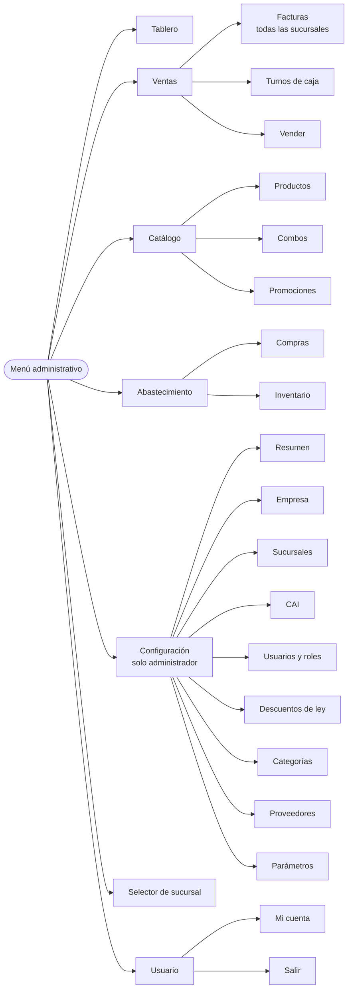
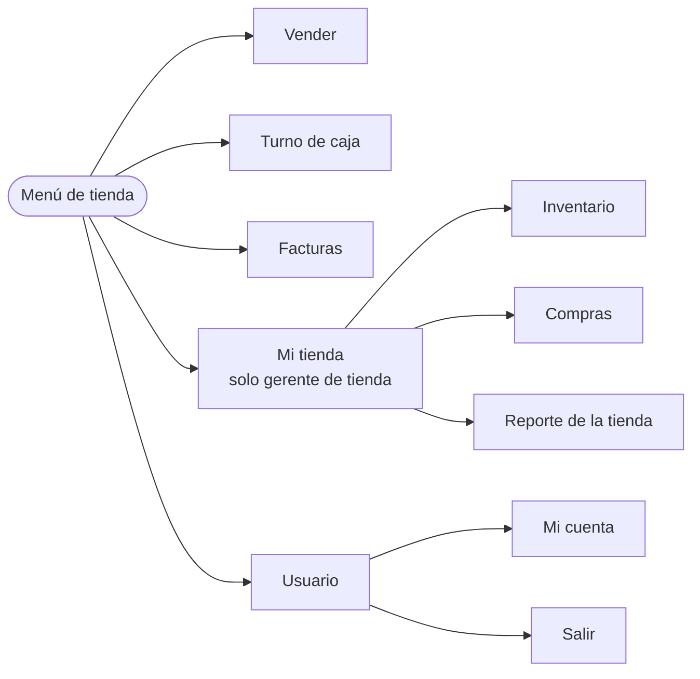
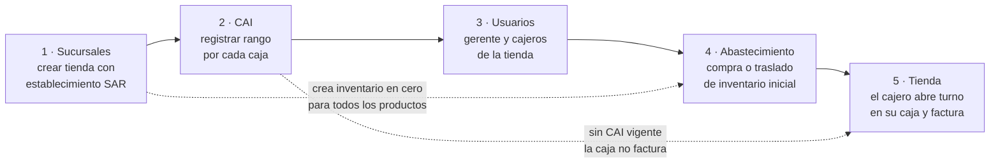

# Power POS — Propuesta de menús y Configuración

Esta propuesta ordena todo lo construido en **dos menús** y una sección de **Configuración**.
Está implementada en esta rama: lo que se describe aquí es lo que hace la plataforma.

---

## 1. La idea: dos menús, según dónde trabaja la persona

| | Menú de tienda | Menú administrativo |
|---|---|---|
| **Quién lo ve** | Usuarios con sucursal asignada: cajeros y gerentes de tienda | Usuarios de oficina central (sin sucursal fija): administradores y gerentes centrales |
| **Dispositivo típico** | Celular o tablet en la sucursal | Computadora |
| **Objetivo** | Vender rápido y cuadrar la caja | Controlar toda la cadena |
| **Opciones** | 3 para el cajero, 4 para el gerente de tienda | 5 grupos |
| **Etiqueta en la barra** | Nombre de la sucursal | "Administración" |
| **Página de inicio** | Vender | Tablero |

La regla es una sola: **si el usuario tiene sucursal asignada, ve el menú de tienda; si no, el administrativo.**
El rol (cajero, gerente, administrador) decide qué opciones aparecen dentro de cada menú.

Por qué separarlos:

- El cajero no necesita ver diez opciones en un celular. Con tres llega a todo lo suyo.
- El catálogo (productos, combos, promociones) es de toda la cadena. Un gerente de tienda no debería poder cambiar el precio de una hamburguesa en todas las sucursales.
- La etiqueta de la barra deja claro en todo momento dónde está la persona y sobre qué sucursal trabaja.

---

## 2. Menú administrativo (oficina central)

| Grupo | Opción | Para qué sirve | Administrador | Gerente central |
|---|---|---|:-:|:-:|
| — | **Tablero** | Ventas, ticket, descuentos, ISV, compras, diferencias de caja, ranking de sucursales y alertas de CAI | ✔ | ✔ |
| Ventas | **Facturas** | Buscar y reimprimir facturas de cualquier sucursal | ✔ | ✔ |
| Ventas | **Turnos de caja** | Ver aperturas y cierres, cerrar turnos olvidados, reportes X y Z | ✔ | ✔ |
| Ventas | **Vender** | Usar la caja en la sucursal seleccionada | ✔ | ✔ |
| Catálogo | **Productos** | Alta, precios y carga masiva CSV | ✔ | ✔ |
| Catálogo | **Combos** | Grupos de selección y recargos | ✔ | ✔ |
| Catálogo | **Promociones** | Mix & match por día, hora y sucursal | ✔ | ✔ |
| Abastecimiento | **Compras** | Facturas de proveedor y recepción | ✔ | ✔ |
| Abastecimiento | **Inventario** | Existencias, mínimos, ajustes, traslados y kárdex | ✔ | ✔ |
| Configuración | las 8 secciones | Ver la sección 4 | ✔ | — |

El **selector de sucursal** de la barra indica sobre qué tienda se trabaja en Vender, Turnos, Compras e Inventario.
El Tablero y Facturas muestran todas las sucursales.

---

## 3. Menú de tienda (sucursal)

| Opción | Para qué sirve | Cajero | Gerente de tienda |
|---|---|:-:|:-:|
| **Vender** | Productos, combos, descuentos de ley, cobro y factura | ✔ | ✔ |
| **Turno de caja** | Abrir con fondo, retiros e ingresos, corte X, arqueo y cierre Z | El suyo | El suyo y cierra los de su tienda |
| **Facturas** | Consultar y reimprimir | Las suyas | Todas las de su tienda |
| Mi tienda → **Inventario** | Existencias, mermas, ajustes y traslados | — | ✔ |
| Mi tienda → **Compras** | Recibir mercadería de proveedores | — | ✔ |
| Mi tienda → **Reporte de la tienda** | Ventas, ticket, horas pico y diferencias de caja de su sucursal | — | ✔ |
| Usuario → **Mi cuenta** | Cambiar su contraseña | ✔ | ✔ |

---

## 4. Configuración

Una sola entrada con un **resumen** que muestra el estado de cada sección y avisa lo que falta
(por ejemplo, "1 sucursal tiene una caja sin CAI vigente").

| Sección | Qué se configura | Validaciones principales |
|---|---|---|
| **Empresa** | Razón social, nombre comercial, RTN, dirección fiscal, teléfono y correo. Muestra cómo sale el encabezado de la factura | RTN de 14 dígitos. Las facturas ya emitidas no cambian |
| **Sucursales** | Alta y edición de tiendas, código interno y **código de establecimiento SAR**. Puede copiar mínimos de inventario y precios especiales de otra sucursal | Establecimiento de 3 dígitos y único. No se cambia después de la primera factura. No se desactiva con turnos abiertos. Siempre queda una activa |
| **CAI** | Rangos autorizados **por sucursal y por caja** (punto de emisión), con filtro por sucursal y avance de uso | Formato del CAI, fecha vigente, rango válido. Rechaza rangos que se crucen en la misma caja y CAI repetidos |
| **Usuarios y roles** | Alta, edición, activación y restablecimiento de contraseña. Muestra qué menú verá cada persona | Correo único. El cajero requiere sucursal. Nadie se desactiva a sí mismo. Siempre queda un administrador. No se desactiva a quien tiene turno abierto |
| **Descuentos de ley** | Porcentajes, topes, acumulación con promociones, exención de ISV y documento requerido | Porcentaje entre 0 y 100 |
| **Categorías** | Nombre y orden de las pestañas del menú de venta | Nombre único |
| **Proveedores** | Alta, edición y activación; muestra cuánto se le ha comprado | RTN de 14 dígitos y único |
| **Parámetros** | Alertas de CAI (días y números), fondo de caja sugerido y mensaje al pie de la factura | Números enteros y montos válidos |

### Estado de cada sucursal

En **Sucursales**, cada tienda muestra si está lista para vender:

- **Lista para vender**: tiene al menos un CAI vigente y al menos un usuario.
- **Falta configurar**: le falta CAI o usuarios; el aviso lleva directo a la pantalla para completarlo.
- **Inactiva**: sus usuarios no pueden ingresar.

---

## 5. Cómo se abre una sucursal nueva

El resumen de Configuración muestra estos cinco pasos y el estado de cada sucursal.

### Varias cajas en una sucursal

Cada caja es un **punto de emisión** con su propio CAI (`004-001-…`, `004-002-…`).
Cuando la sucursal tiene más de una caja con CAI vigente, el cajero **elige su caja al abrir el turno**
y todas sus facturas salen del rango de esa caja. Con una sola caja no se le pregunta nada.

---

## 6. Matriz de permisos

| Función | Cajero | Gerente de tienda | Gerente central | Administrador |
|---|:-:|:-:|:-:|:-:|
| Vender, turno de caja, mi cuenta | ✔ | ✔ | ✔ | ✔ |
| Facturas | Las suyas | Su sucursal | Todas | Todas |
| Cerrar turnos de otros cajeros | — | Su sucursal | ✔ | ✔ |
| Inventario y compras | — | Su sucursal | ✔ | ✔ |
| Reporte / tablero | — | Su sucursal | Todas | Todas |
| Catálogo: productos, combos y promociones | — | — | ✔ | ✔ |
| Configuración | — | — | — | ✔ |

Los permisos se revisan **en cada pantalla contra la base de datos**: si a alguien lo desactivan, le cambian el rol
o cierran su sucursal, el cambio aplica de inmediato, sin esperar a que cierre sesión.

---

## 7. Qué cambia respecto a la versión anterior

| Antes | Ahora |
|---|---|
| Una barra con 10 enlaces para todos | Dos menús con grupos desplegables |
| CAI y Descuentos de ley como pantallas sueltas | Dentro de Configuración (los enlaces antiguos redirigen) |
| Las sucursales y los usuarios se creaban en la base de datos | Se crean desde Configuración |
| Cualquier gerente editaba el catálogo | Solo oficina central. El gerente de tienda gestiona inventario, compras y su reporte |
| Una sucursal tomaba números de cualquiera de sus CAI | Cada turno pertenece a una caja y factura con el CAI de esa caja |
| Un CAI agotado seguía avisando aunque ya hubiera otro | Las alertas se calculan por sucursal y caja, sumando todos sus CAI |
| Alertas de CAI en un archivo de configuración | Parámetros editables en pantalla |
| El cajero no podía cambiar su contraseña ni reimprimir | Mi cuenta y Facturas |

Para instalaciones existentes: `database/migraciones/003_configuracion.sql`.

---

## 8. Siguientes mejoras propuestas

Ordenadas por el valor que aportan a la operación:

1. **Anulación de facturas y notas de crédito**, con autorización del gerente y devolución al inventario.
2. **Precios por sucursal desde pantalla**. La tabla ya existe; falta la pantalla para editarlos.
3. **Bitácora de auditoría**: quién cambió qué en Configuración y en el catálogo, y cuándo.
4. **Cajas con nombre e impresora**: hoy una caja es solo su punto de emisión.
5. **Permisos por función**, para casos como "cajero que también recibe compras".
6. **Recetas e insumos**: descontar pan, carne y queso en vez del producto terminado.
7. **Metas por sucursal** en el tablero y comparación contra el período anterior.
8. **Recuperación de contraseña por correo** y segundo factor para administradores.
