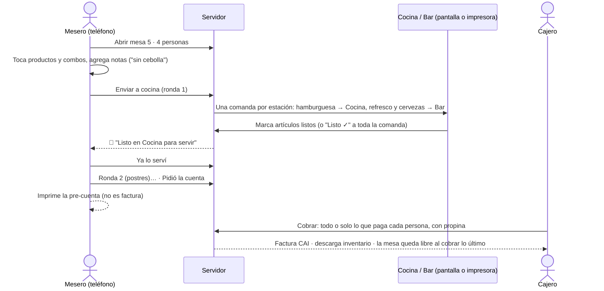
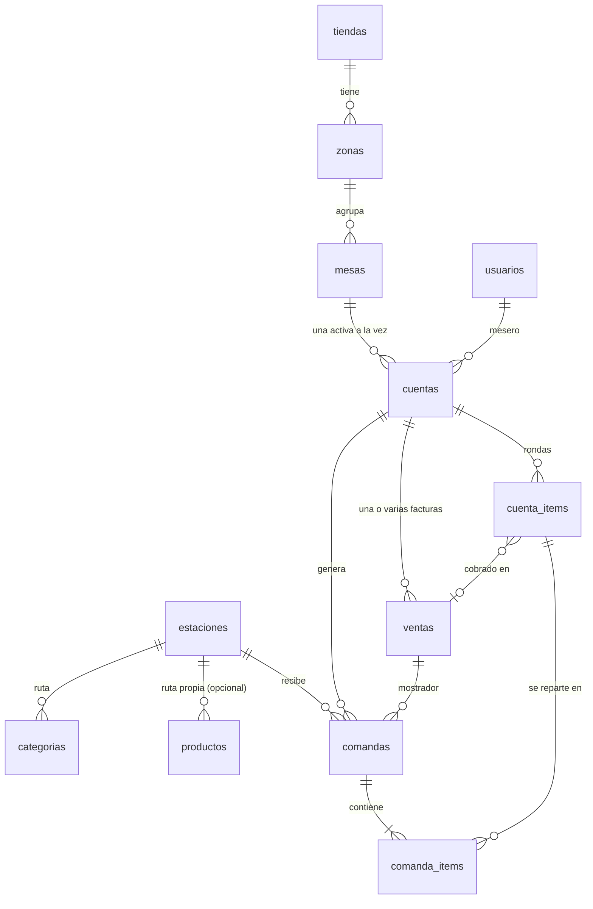

# Power POS — Restaurante: mesas, meseros y comandas a cocina

Este módulo agrega la atención en mesa a la caja rápida, para restaurantes ejecutivos o para la parte de
servicio en mesa de un local de comida rápida. Los precios, las promociones, los descuentos de ley,
el ISV, la facturación con CAI, el inventario y el arqueo de caja son **los mismos** de la caja de
mostrador. Solo cambia cómo se toma y se sigue el pedido.

## 1. Quién hace qué

| Rol | Salón y mesas | Cocina (pantalla) | Cobrar | Configurar salón y personal |
|---|---|---|---|---|
| **MESERO** | Abre mesas a su nombre, toma pedidos, los envía, marca lo servido, pide la cuenta, imprime la pre-cuenta, transfiere de mesa | ❌ | ❌ | ❌ |
| **COCINA** | ❌ | ✅ solo esto: marca listo, despacha, recupera, imprime | ❌ | ❌ |
| **CAJERO** | Igual que el mesero y además asigna la mesa a otro mesero al abrirla | ✅ (para el equipo que imprime) | ✅ con su turno abierto | ❌ |
| **GERENTE** | Todo lo anterior, más anular lo enviado, cambiar de mesero y liberar mesas | ✅ | ✅ | ✅ personal operativo de su tienda |
| **ADMIN** | Todo | ✅ | ✅ | ✅ todo |

Cada rol entra directo a su pantalla: el mesero al **Salón**, la cocina a **Cocina** y el cajero a **Vender**.

## 2. El servicio paso a paso

### Salón
Las mesas se ven por zona (Salón, Terraza, VIP…) con su estado, y se actualizan solas cada 10 segundos:

| Color | Estado |
|---|---|
| Blanco | Libre |
| Azul | Ocupada: mesero, personas, tiempo, cuántas comandas siguen en cocina |
| Verde | 🔔 Hay comida lista para servir |
| Naranja | 💳 Pidió la cuenta |

"Solo mis mesas" deja ver al mesero sus mesas y las libres.

### Cuenta de mesa
- **Por enviar**: lo que el mesero va tomando. Se guarda en el teléfono hasta enviarlo: si se recarga la
  página no se pierde, y si intenta salir con algo pendiente el navegador le avisa.
- **Notas para cocina** por artículo, con sugerencias rápidas (sin cebolla, término medio, sin hielo…).
- **Rondas**: cada envío es una ronda con hora y quién la envió. Así se piden entradas primero y el plato
  fuerte después.
- **En la mesa**: cada artículo muestra su estado: ⏳ en preparación, 🔔 listo, ✓ servido, anulado o cobrado.
- **Anular lo enviado**: solo gerencia y con motivo. La estación recibe una **comanda de anulación** en rojo,
  que también se imprime, y el artículo queda tachado en la comanda original.
- **Más opciones**: pasar la cuenta a otra mesa libre (lo que sigue en cocina cambia de mesa), cambiar el número
  de personas, y para gerencia cambiar el mesero o liberar una mesa abierta por error.

### Cobro y cuenta dividida
El cajero abre la mesa y toca **Cobrar**:
1. Marca lo que paga esta persona (por defecto, todo lo pendiente). Lo no marcado queda en la mesa para otra factura.
2. Si aplica, elige el descuento de ley y desmarca "Beneficiario" en lo que no consumió la persona beneficiada.
3. Pone el RTN si piden factura a nombre de una empresa.
4. Elige la forma de pago y la **propina** (botones Sin propina / 10 % / 15 % o el monto exacto) y con qué se paga.
5. **Facturar** emite la factura CAI. Cuando se cobra lo último, la mesa queda libre.

Dos cajeros no pueden cobrar el mismo artículo: si ocurre al mismo tiempo, el segundo recibe un aviso y su
factura no se emite, así que no consume número de CAI.

### Propina
- Es **voluntaria** y **no forma parte de la factura**: no entra en el total facturado ni en la base del ISV.
  En la factura aparece aparte: "Propina voluntaria recibida: L X (no forma parte de esta factura)".
- La pre-cuenta muestra la propina sugerida (`propina_sugerida` en `config.php`, 10 % por defecto).
- Si el cliente paga en efectivo y deja la propina en efectivo, el efectivo recibido debe cubrir las dos y el
  **cambio** se calcula sobre ambas.
- La propina en efectivo queda en la caja hasta que se entrega: el **efectivo esperado** del arqueo la incluye.
  El **cierre Z** trae las **propinas por mesero**. Al entregarlas, registre un retiro "Pago de propinas".

> Valide con su contador la forma de documentar la propina ante la SAR y en planilla.

## 3. Cocina: pantalla e impresora

### Estaciones y rutas
Cada **estación** (Cocina, Bar, Parrilla, Postres…) recibe solo lo que prepara:
- Cada **categoría** va a una estación (Configurar salón y cocina → "¿A dónde va cada categoría?").
- Un **producto** puede ir a otra estación distinta de la de su categoría (Productos → "Se prepara en").
- Los **combos se reparten por componente**: en el Combo Clásico, la hamburguesa y las papas van a Cocina
  y el refresco al Bar. La estación de la categoría del combo siempre lo recibe, porque ahí se prepara la
  parte fija (el pollo del "Combo Pollo").
- Si la estación asignada está desactivada, va a la primera activa. Sin estaciones activas no se generan comandas.

Las ventas de **mostrador** también salen a cocina. La referencia es el nombre del cliente, si lo dieron, o
los últimos dígitos de la factura (`Mostrador · #0012`) para llamarlo. Para apagarlo:
`'comandas_mostrador' => false` en `config.php`.

### Pantalla de cocina (KDS)
`index.php?p=cocina&estacion=N`, o "Todas" para una sola pantalla que vea todo:
- Las comandas aparecen en orden de llegada y se actualizan cada 4 segundos. El reloj de cada una cambia a
  naranja a los 10 minutos y a rojo a los 20.
- Tocar un artículo lo marca listo. Cuando no queda nada pendiente, la comanda sale de la pantalla sola, o con **Listo ✓**.
- **Despachadas recientemente** permite **Recuperar** una comanda despachada por error.
- 🔔 **Sonido** al llegar una comanda nueva (el navegador lo permite después de tocar la pantalla una vez).

### Impresión de comandas
En la pantalla de la estación, active **🖨 Imprimir automáticamente** en el equipo que tiene conectada la
impresora térmica de 80 mm (puede ser la PC de la caja). Cada comanda nueva se imprime **una sola vez**,
aunque haya dos pantallas de la misma estación con la opción activa: la primera que la toma la marca como impresa.
El botón 🖨 de cada comanda reimprime.

Para que imprima sin mostrar el cuadro de diálogo:
1. Instale la impresora térmica y póngala como **predeterminada** en Windows.
2. Abra Chrome con impresión silenciosa: cree un acceso directo con
   `chrome.exe --kiosk-printing "https://su-dominio.com/index.php?p=cocina&estacion=1"`.
3. Ingrese con el usuario de cocina y active **🖨 Imprimir automáticamente**. La opción queda guardada en ese equipo.

¿Solo impresora, sin pantalla? Use la misma página en la PC conectada a la impresora con impresión automática;
la cocina trabaja con el papel. Las comandas que nadie despacha dejan de mostrarse después de 24 horas.

## 4. Configuración inicial
1. **Personal**: cree los usuarios de los meseros (rol Mesero) y uno para cada pantalla de cocina (rol Cocina).
2. **Mesas → Configurar salón y cocina**:
   - Zonas: Salón, Terraza…
   - Mesas: una por una, o "Crear varias de una vez" (prefijo "T" del 1 al 6 → T1…T6).
   - Estaciones: Cocina, Bar…, y la ruta de cada categoría.
3. En cada estación abra su pantalla (enlace "Abrir pantalla") en una tablet o PC, e ingrese con el usuario de cocina.

## 5. Modelo de datos

| Tabla | Para qué |
|---|---|
| `zonas`, `mesas` | El salón de cada tienda. El nombre de la mesa es único en la tienda |
| `estaciones` | Dónde se prepara. Son compartidas por todas las tiendas, como el catálogo |
| `cuentas` | La mesa abierta: mesero, personas y estado (`ABIERTA`, `POR_COBRAR`, `COBRADA`, `ANULADA`). La columna generada `mesa_activa` con índice único impide abrir dos veces la misma mesa |
| `cuenta_items` | Lo pedido, ronda por ronda, con nota. `venta_id` indica con qué factura se cobró, y eso permite dividir la cuenta. No guarda precios: se calculan al cobrar |
| `comandas`, `comanda_items` | Lo que recibe cada estación, con estado `EN_COCINA` → `LISTA` → `ENTREGADA`, tipo `PEDIDO` o `ANULACION`, e `impresa_en` para no imprimir dos veces |
| `ventas.cuenta_id`, `ventas.propina`, `ventas.propina_efectivo` | Factura de mesa y propina fuera del total facturado |

Código: `src/Mesas/CuentasService.php` (abrir, enviar rondas, anular, transferir, cobrar),
`src/Mesas/MesasService.php` (salón y configuración), `src/Cocina/ComandasService.php` (rutas, pantalla,
impresión) y `src/Usuarios/UsuariosService.php` (personal). Pruebas: `tests/restaurante.php` (54 casos).

## 6. Instalar o actualizar
- Instalación nueva: `schema.sql` + `seed.sql` ya traen todo. Los datos de demostración incluyen un salón en
  Power Morazán con 12 mesas, las estaciones Cocina y Bar y los usuarios `mesero1@power.hn`, `mesero2@power.hn`
  y `cocina1@power.hn` (clave `Power2026!`).
- Instalación existente: `mysql -u root -p < database/migraciones/003_mesas_meseros_cocina.sql`, que crea la
  estación "Cocina". En Hostinger, importe `base_de_datos/actualizar_003_mesas_meseros_cocina.sql` del paquete.

## 7. Pendiente para siguientes versiones
- Juntar mesas (una cuenta para varias mesas) y dividir una línea en partes (3 cervezas: 2 y 1).
- Modificadores con precio (extra queso +L 15) y tiempos de servicio ("marchar" el plato fuerte).
- Reservaciones y mapa del salón con la posición real de las mesas.
- Agente de impresión local (ESC/POS por red) para imprimir sin una pantalla abierta.
- Reporte de tiempos de cocina y de ventas y propinas por mesero en el Tablero ERP.
